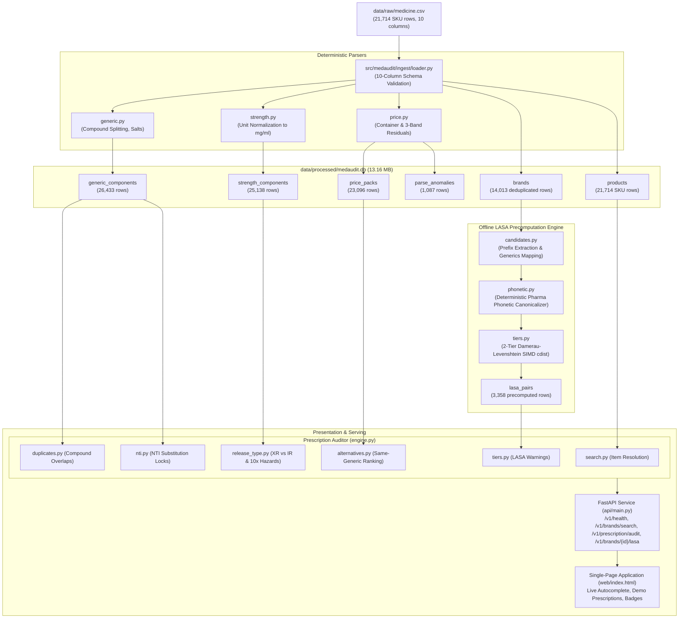
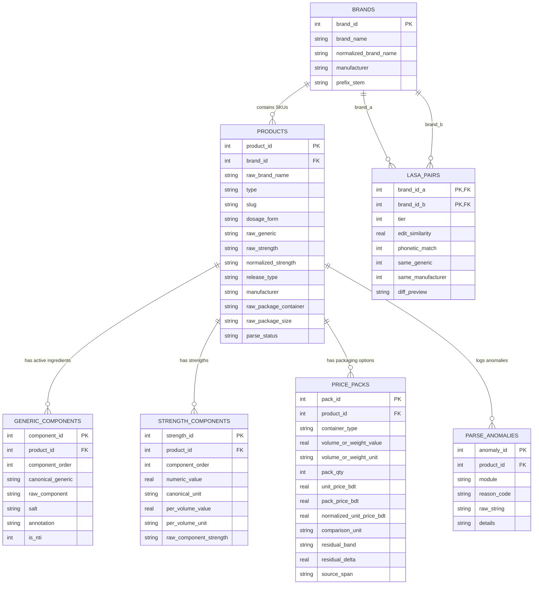
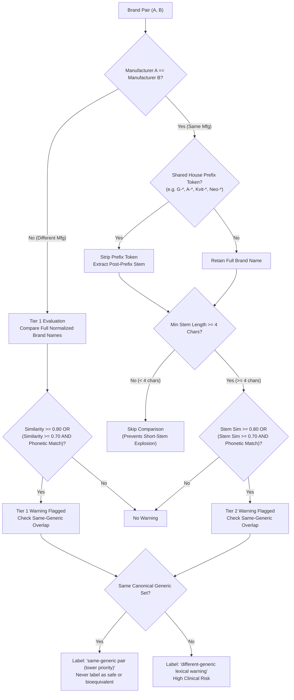

# MedAudit-BD: Architecture & Technical Design

## 1. System Overview & Data Flow

MedAudit-BD is a high-performance, deterministic prescription audit and look-alike sound-alike (LASA) decision-support engine engineered specifically for the Bangladeshi pharmaceutical market.



---

## 2. SQLite Database Schema (6 Tables + Anomalies)

The persistence layer separates SKU-level product variations from deduplicated brand entities, indexing foreign keys and text search vectors for sub-millisecond execution.

### Relational Schema Diagram


---

## 3. Package Container & Arithmetic Residual Classifier Design

The package container string parser (`price.py`) extracts discrete packaging container models and validates unit price against total pack price using arithmetic residuals:

$$\text{Residual } \Delta = |\text{pack\_price\_bdt} - (\text{unit\_price\_bdt} \times \text{pack\_qty})|$$

```
+---------------------------------------------------------------------------------+
| Raw Container String: "3 x 10's Pack: ৳ 210.00 (Unit Price: ৳ 7.00)"            |
+---------------------------------------------------------------------------------+
                                       |
                                       v
                     [ Tokenizer & Multi-Pack Multiplier ]
                      Container: Blister Pack | Qty: 30
                                       |
                                       v
         [ Arithmetic Residual: |210.00 - (7.00 * 30)| = |210.00 - 210.00| = 0.00 ]
                                       |
          +----------------------------+----------------------------+
          |                                                         |
          v                                                         v
   Delta <= 0.01 BDT                                         Delta > 0.01 BDT
+-----------------------+                                           |
|     BAND 1: EXACT     |                                           v
|  (22,958 rows, 99.4%) |                           +-------------------------------+
+-----------------------+                           | Delta <= 0.05 * Pack Price OR |
                                                    | Drift <= 0.50 BDT             |
                                                    +-------------------------------+
                                                              |           |
                                                            Yes           No
                                                              |           |
                                                              v           v
                                                    +-------------+ +--------------------+
                                                    |   BAND 2:   | |      BAND 3:       |
                                                    |  ROUNDING   | |  HARD DISCREPANCY  |
                                                    |    DRIFT    | | (Logged to         |
                                                    |  (116 rows) | |  parse_anomalies)  |
                                                    |             | | (22 rows)          |
                                                    +-------------+ +--------------------+
```

---

## 4. 2-Tier LASA Brand-Name Warning Architecture

Look-Alike Sound-Alike (LASA) brand confusion represents a primary medication hazard in Bangladesh. The 2-Tier LASA pipeline evaluates 14,013 deduplicated brand names using normalized Damerau-Levenshtein distance (which satisfies the metric space triangle inequality) combined with pharmaceutical phonetic matching:



### Deterministic Phonetic Canonicalizer (`phonetic.py`)
Zero-dependency canonicalizer operating without Soundex 4-character truncation:
1. Strips non-alphabetic characters and lowercases.
2. Normalizes pharma digraphs: `ph -> f`, `ch -> k`, `rh -> r`, `th -> t`, `c([eiy]) -> s`, `c -> k`, `q -> k`, `x -> z`, `y -> i`.
3. Strips silent `h` after consonants (`gh`, `dh`, `bh`, `kh`).
4. Collapses consecutive duplicate letters.
5. Strips all vowels (`a, e, i, o, u`) except the very first character of the string.
6. Re-collapses consecutive duplicate letters.
